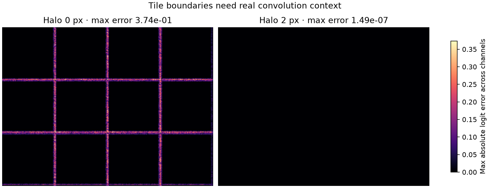
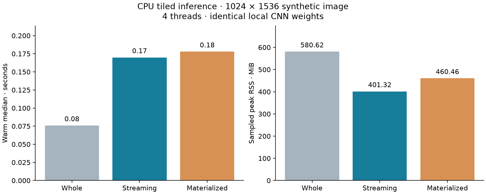

# TileFlow Inference

**Large-image inference without materializing every tile.**

TileFlow runs a spatially preserving PyTorch model over an image in bounded tile batches,
supplies real context around each tile, and stitches overlapping logits into one output.
It includes the numerical tests and process-isolated benchmark needed to check whether
tiling is actually correct and useful for a particular model.

The motivating workload is dense prediction over large geospatial images. The current
implementation operates on CPU tensors; raster file I/O and georeferencing belong in
the caller. This is an inference-systems project, with a deliberately explicit boundary
between numerical correctness and model accuracy.



## Use it

Python 3.12, with a fresh virtual environment:

```bash
git clone https://github.com/dimxxkun/tileflow-inference.git
cd tileflow-inference
python -m venv .venv
# Linux/macOS: source .venv/bin/activate
# Windows PowerShell: .venv\Scripts\Activate.ps1
python -m pip install -r requirements-lock.txt
python -m pip install --no-deps -e .
```

```python
import torch
from tileflow import TileConfig, tiled_predict
from tileflow.models import local_model

torch.set_num_threads(4)
model = local_model().eval()  # Untrained radius-two CNN for this numerical example.
image = torch.rand(3, 1024, 1536)  # CPU float32, channels first.

logits = tiled_predict(
    model,
    image,
    TileConfig(tile_size=256, overlap=64, halo=2, batch_size=4),
)
assert logits.shape == (4, 1024, 1536)
labels = logits.argmax(dim=0)  # Blend logits before choosing a class.
```

Substitute your trained model only after checking its output geometry, receptive field,
normalization and whole-frame parity. The example's random weights do not produce useful
semantic labels.

## Measured CPU comparison

Results are generated by the benchmark command below and retained as raw JSON, including
every warm timing sample, process CPU time, RSS estimates and output-error measurements.
The chart compares a direct whole-image pass, streaming tiles, and a control that copies
all input tiles into memory first.



| Mode | Warm median | Sampled peak RSS | Max absolute logit error |
|---|---:|---:|---:|
| Whole | 75.88 ms | 580.6 MiB | 0.00e+00 |
| Streaming | 169.89 ms | 401.3 MiB | 1.19e-07 |
| Materialized | 177.87 ms | 460.5 MiB | 1.19e-07 |


Hardware: AMD Ryzen 7 8700G, 32 GB RAM, Windows, PyTorch 2.15.0 CPU, four threads.
Image: 1,024 × 1,536 RGB. Tiles: 256 px, overlap 64 px, halo 2 px, batch size 4.
Five warm repetitions follow one separately reported cold call. Each mode uses a fresh
process. RSS is sampled every 5 ms and can miss brief peaks; it includes the resident
input, model and output. This is a single-machine observation, not a universal speedup.

The benchmark uses a **synthetic random image and an untrained local CNN**. It establishes
numerical equivalence and allocation/timing behaviour; it does not measure segmentation
accuracy on satellite imagery. Tiling can cost latency while reducing activation memory.

## Reproduce and diagnose

```bash
tileflow benchmark --height 1024 --width 1536 --tile-size 256 --overlap 64 --halo 2 --batch-size 4 --threads 4 --repeats 5 --output runs/benchmark
python examples/seam_diagnostic.py --output runs/seam-diagnostic.png
pytest -q
ruff check .
ruff format --check .
```

The benchmark exits with an error if any mode fails whole-frame numerical parity
(`rtol=1e-5`, `atol=1e-6`). It also reports max/mean absolute logit error and argmax agreement.
To see the failure mode, rerun a small case with `--halo 0`: the retained report should
show failed parity for tiled execution. Use a different output directory for each run.

## Design decisions

| Decision | Reason |
|---|---|
| Halo separate from overlap | Context determines each prediction; blending only combines available predictions |
| Clip halo at the real image boundary | Preserve the model's own layer-padding behaviour at outer edges |
| Blend logits with positive weights | Avoid uncovered edges and discontinuities caused by per-tile argmax |
| Batch consecutive equal input shapes | Bound retained tiles without a growing collection of partial batches |
| Float32 accumulation | Keep stitching explicit and avoid low-precision accumulation loss |
| Check model mode, geometry and finite values | Fail at the boundary where an invalid inference result is produced |
| Fresh process per benchmark mode | Reduce contamination from another mode's retained allocator state |

The source image, output accumulator and weight denominator remain resident. This
release bounds tile activations and tile copies; it is not an out-of-core raster engine.
Very large output rasters still need a disk-backed or windowed sink.

## Where parity does not apply

The included model uses two stride-one 3 × 3 convolutions, so a halo of two pixels is
sufficient. An arbitrary network may require more context or a different tiling contract.
Global attention, image-wide pooling, spatial group/instance normalization, encoder stride
alignment, and interpolation can invalidate whole-frame equality. One regression test
uses a global-mean operation specifically to demonstrate this limitation.

GPU execution, mixed precision, downsampled outputs and geoTIFF handling are outside this
release's supported interface. See the [design and measurement protocol](docs/design.md)
for the exact guarantees, boundary reasoning and timing exclusions.

## Evidence and ownership

- [Raw benchmark report](results/cpu-1024x1536/benchmark.json)
- [Numerical and failure-path tests](tests/test_inference.py)
- [Seam diagnostic source](examples/seam_diagnostic.py)
- [Implementation](src/tileflow/core.py)

Built by [Sanusi Abdulfatai Oyewunmi](https://www.sanusiabdulfatai.com), a geospatial
software engineer, with coding-agent assistance. This is a new portfolio implementation,
not a claim of an existing production deployment. MIT licensed.
