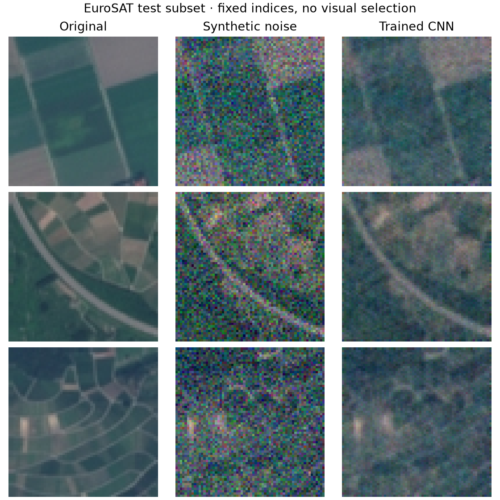

# Trained inference on real EuroSAT images

## Question

Can the same halo-aware tiling code preserve a trained model's output on real image content, and what memory/latency trade-off does it make? Denoising provides a spatially preserving RGB task with a directly measurable target and a local receptive field. This experiment complements the original untrained numerical fixture.

## Fixed protocol

- Data: EuroSAT RGB, using the existing GeoVision manifest with SHA-256 `4c1cc4bf7d2ab439f5e16f41d83a421d6e9da56c8ea1e07600a4fe42523785fa`.
- Subsets: the first 100 training, 20 validation and 20 test manifest rows per class. This gives 1,000 / 200 / 200 real 64×64 RGB images. Every loaded file is checked against its SHA-256. The selected paths and digests are published in `subset.json`.
- Corruption: Gaussian noise with sigma 0.1 after scaling clean pixels to [0,1]; noisy inputs are clipped to that range. Training noise changes each batch. Validation and test noise use separate fixed seeds.
- Model: two 3×3 convolutions, 3→16→3 channels, ReLU and a residual subtraction. There are 883 learned parameters and a radius-two receptive field. No pretrained weights or global normalization.
- Training: seed 2026, ten epochs, Adam at 0.001, batch size 32, finite-loss checks and gradient clipping. The lowest fixed-noise validation MSE selects the checkpoint. Test images are loaded after model selection.
- Quality: aggregate mean pixel MSE and PSNR = −10 log10(MSE) for unit-range targets. Predictions are not clipped for metrics; clipping is used only to display the example figure. This is aggregate PSNR, not a mean of per-image PSNR values.

## Measured quality

| Held-out test input/output | MSE | PSNR |
|---|---:|---:|
| Noisy input baseline | 0.00976108 | 20.1050 dB |
| Trained CNN, epoch 10 | 0.00167252 | 27.7663 dB |

The improvement is **7.6613 dB** on this fixed 200-image test subset. No architecture or seed search was performed. This is a small baseline, not a state-of-the-art claim.



## Systems benchmark

The example constructs a 768×1,024 RGB fixture from 192 deterministically ordered test patches and adds separately seeded noise. Patch adjacency is artificial; this is not a contiguous satellite scene. Its input digest and checkpoint digest are retained. Quality above is measured on individual test patches, independently of this mosaic.

The benchmark loads the trained checkpoint and the same noisy mosaic in a fresh process for each mode. It records one cold call, five warm calls, process CPU time, 5 ms sampled RSS, and output parity against whole-frame inference (`rtol=1e-5`, `atol=1e-6`). Setup and input/model loading are excluded from timing. A failed parity gate produces a nonzero exit. There is no class argmax metric for RGB regression.

| Mode | Warm median | Sampled peak RSS | Maximum absolute output error |
|---|---:|---:|---:|
| Whole frame | 36.03 ms | 448.11 MiB | 0 |
| Streaming tiles | 62.30 ms | 362.40 MiB | 1.79e-7 |
| Materialized tiles | 60.46 ms | 375.43 MiB | 1.79e-7 |

All modes passed parity. Streaming reduced sampled peak RSS by about 19% compared with
whole-frame inference, while taking longer. The small streaming/materialized timing
difference is one observation, not evidence of a stable ranking. Measurements used an
AMD Ryzen 7 8700G, Windows, PyTorch 2.15.0 CPU and four threads, after the separate
classification training job had finished.

See the [raw benchmark](../results/eurosat-denoising/benchmark/benchmark.json) and [trade-off chart](../results/eurosat-denoising/benchmark/tradeoff.png) for measured timings and memory. Sampling may miss brief memory peaks. Whole-frame inference can be faster than streaming tiles; tiling is not advertised as a universal speed improvement.

## Reproduce

Use Python 3.12 and the TileFlow locked environment from the main README. Clone GeoVision beside TileFlow and install its dataset helper without replacing the locked dependencies:

```bash
# From the tileflow-inference checkout, with its environment activated:
git clone https://github.com/dimxxkun/geovision-bench.git ../geovision-bench
python -m pip install --no-deps -e ../geovision-bench
geovision prepare --data data --seed 2026
python examples/train_eurosat.py --root data/extracted/EuroSAT_RGB --manifest data/manifest.json --output runs/denoising --epochs 10 --threads 4
tileflow benchmark --checkpoint runs/denoising/best.pt --image runs/denoising/mosaic.npy --tile-size 256 --overlap 64 --halo 2 --batch-size 4 --threads 4 --repeats 5 --output runs/denoising/benchmark
```

Use an empty training output directory. Checkpoint weights, dataset images and generated arrays stay local; the small evidence reports and example figure are committed. The dataset manifest digest is the cross-project data contract. GeoVision's data loader verifies the image bytes; the TileFlow core remains independent of that package.

## Limitations and attribution

This is one seed on a deliberately small subset and one CPU machine. Noise is simulated: the experiment does not establish restoration quality on real sensor corruption. Image-level splitting does not control geographic neighbours or near duplicates. The model may remove real detail along with noise, as the example images show. It is not a segmentation model or an operational geospatial product.

EuroSAT is by Patrick Helber, Benjamin Bischke, Andreas Dengel and Damian Borth: [official project](https://github.com/phelber/EuroSAT), [RGB dataset v2](https://zenodo.org/records/7711810). Dataset/source-imagery terms remain with their owners. Code is MIT licensed. This portfolio experiment was developed with coding-agent assistance; results come from the recorded local executions.
